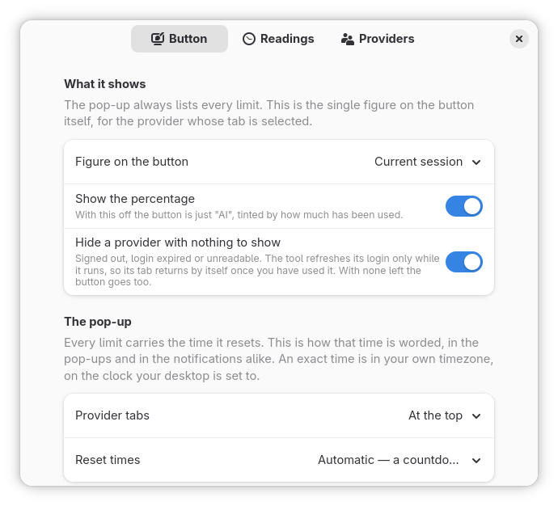
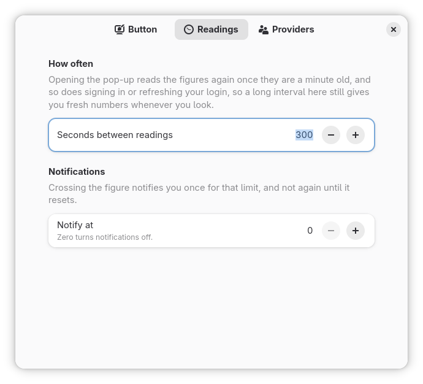
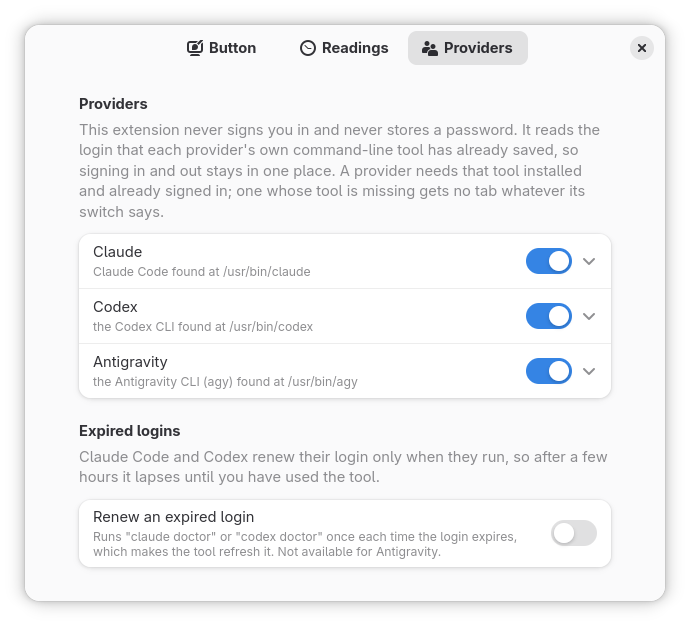

# AI Usage

Shows how much of your AI subscriptions' rate limits you have used, as a button in the
GNOME Shell top bar.


## What it does

- **One button** showing "AI" and the selected subscription's figure, amber at 80% and
  red at 95%.
- **A tab per subscription** listing the session, the week and each model, with the time
  each resets.
- **The provider's own figures**, the same ones its command-line tool shows.
- **Refresh renews an expired login**: for Claude and Codex, the refresh button runs the
  tool's own `doctor`, which refreshes the login.
- **An optional notification** when a limit passes a figure you choose.

## Providers

| Provider | Needs |
| --- | --- |
| Claude | Claude Code (`claude`), signed in |
| Antigravity | the Antigravity CLI (`agy`), signed in |
| Codex | the Codex CLI (`codex`), signed in with ChatGPT |

The extension never signs you in. It reads the login the tool has already stored, and a
provider whose tool is not installed gets no tab. When a login expires, its tab says so:
press refresh (Claude, Codex) or run the tool once (Antigravity, whose login lasts an hour
from when `agy` last started).

## Requirements

- GNOME Shell 51.
- Each provider's tool, signed in, on the `PATH` GNOME Shell was started with.
- libsecret's introspection data (Debian and Ubuntu: `gir1.2-secret-1`), usually there
  already.

## Privacy

Each reading sends the stored login to that provider's own server, the request its tool
makes itself:

| Provider | Reads | Sends it to |
| --- | --- | --- |
| Claude | `~/.claude/.credentials.json`, the plan from `~/.claude.json` | `api.anthropic.com` |
| Antigravity | the system keyring, or `~/.gemini/antigravity-cli/antigravity-oauth-token` | `daily-cloudcode-pa.googleapis.com` (`cloudcode-pa` for a GCP login) |
| Codex | `$CODEX_HOME/auth.json` or `~/.codex/auth.json`, else the system keyring | `chatgpt.com` |

Nothing else goes anywhere. It never writes to these files, keeps a token or logs one, and
the only process it starts is the tool's `doctor`. These endpoints are not published APIs,
so a provider may change them; the pop-up then says the usage could not be read.

## Install

Not on extensions.gnome.org yet. From source, with `make`, `glib-compile-schemas` and
`gnome-extensions`:

```sh
git clone https://github.com/Jackicus/GNOME-AI-Usage
cd GNOME-AI-Usage
make install
```

**Log out and back in**, then `gnome-extensions enable ai-usage@jackicus`.

To update: `git pull && make install`, then log out and in. To remove: `make uninstall`.

## Preferences

`gnome-extensions prefs ai-usage@jackicus`, or the Extensions app.

| Button | Readings | Providers |
| --- | --- | --- |
|  |  |  |

## Troubleshooting

```sh
journalctl -f -o cat /usr/bin/gnome-shell | grep -i 'ai usage'
journalctl -f -o cat SYSLOG_IDENTIFIER=org.gnome.Shell.Extensions   # the preferences
```

- **A provider has no tab**: its switch is off, or its tool is not on the session's
  `PATH` (a directory only your terminal adds does not count).
- **The button is amber with no figure**: a login has expired or is missing. Press
  refresh, or run the tool once.
- **No button after installing**: log out and back in, then enable it.

## Development

`make link`, `make reload` and `make check`; `make nested` runs it in a nested shell. See
[CONTRIBUTING.md](CONTRIBUTING.md), and [CLAUDE.md](CLAUDE.md) for the design.

## Licence

GPL-2.0-or-later. See [LICENSE](LICENSE).

## Trademarks

Claude is a trademark of Anthropic, Antigravity of Google, and Codex and OpenAI of OpenAI.
The names only say which service a figure belongs to; this extension is not affiliated
with or endorsed by any of them, and ships none of their logos. The figures in the
screenshots are invented.
