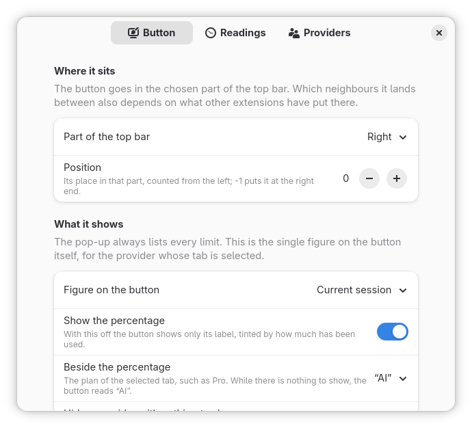
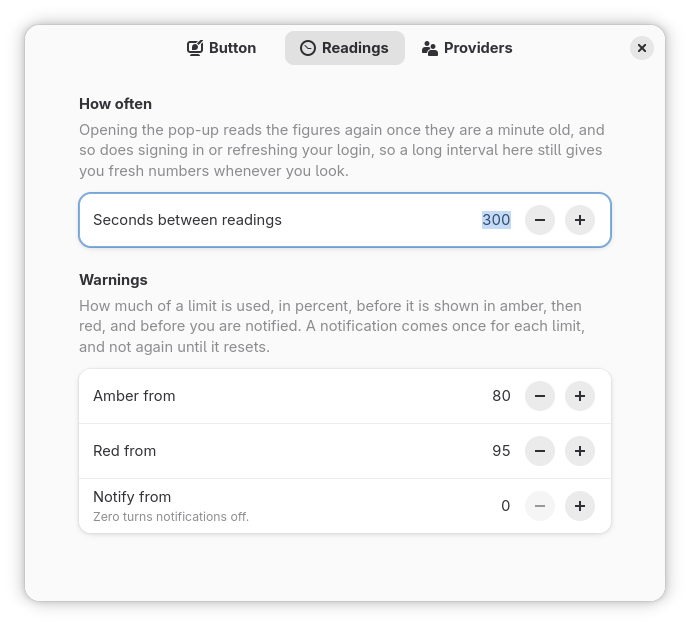
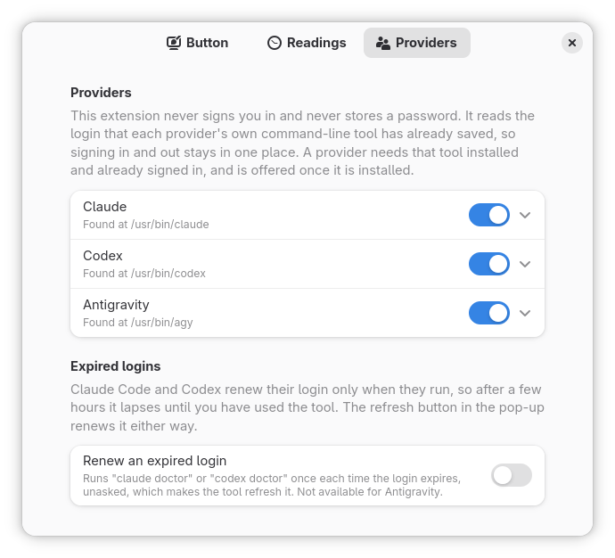

# AI Usage

Shows how much of your AI subscriptions' rate limits you have used, and what your local
Ollama models did this session, as a button in the GNOME Shell top bar.


## What it does

- **One button**, just after the workspaces at the left of the top bar, showing the selected
  subscription's figure beside its plan name, an image of your choosing or nothing, amber at
  80% and red at 95%.
- **A tab per subscription** listing the session, the week and each model, with the time
  each resets.
- **A simple view**, if you prefer: one provider's session card, weekly card or both, and
  nothing else in the pop-up.
- **The provider's own figures**, the same ones its command-line tool shows.
- **An Ollama tab** listing the local server's models: which are in memory (how much, on
  the GPU or the CPU, the context, when each unloads), and for each model used this
  session how many times it was loaded, how long it stayed in memory and when it was last
  used.
- **A failed reading keeps the last figures**, saying why they could not be updated and
  when they are from, and reads again when the network comes back.
- **An expired login is renewed**: for Claude and Codex, once a login lapses (as it has by
  the time you log in), the tool's own `doctor` runs once and refreshes it, so the figures
  show before you have opened the tool. "Wait until the tool is opened" in the preferences
  turns that off; the refresh button still renews it.
- **An optional notification** when a limit passes a figure you choose.

## Providers

| Provider | Needs |
| --- | --- |
| Claude | Claude Code (`claude`), signed in |
| Antigravity | the Antigravity CLI (`agy`), signed in |
| Codex | the Codex CLI (`codex`), signed in with ChatGPT |
| Ollama | Ollama (`ollama`), its server running |

The extension never signs you in. It reads the login the tool has already stored, and a
provider whose tool is not installed gets no tab. When a login expires, its tab says so:
press refresh (Claude, Codex) or run the tool once (Antigravity, whose login lasts an hour
from when `agy` last started).

Ollama has no limits and no login. Its server keeps no count of what each model did, so the
extension looks at what the server holds in memory every 15 seconds and adds it up itself:
a model loaded and unloaded between two looks is missed, and use while the screen is locked
is not counted. The figures are kept in a file in `$XDG_RUNTIME_DIR` until you log out.
`OLLAMA_HOST` is read as the CLI reads it, from GNOME Shell's environment.


## Requirements

- GNOME Shell 51.
- Each provider's tool, signed in, on the `PATH` GNOME Shell was started with.
- libsecret's introspection data (Debian and Ubuntu: `gir1.2-secret-1`), usually there
  already.

## Privacy

Each reading sends the stored login to that provider's own server, the request its tool
makes itself:

| Provider | Reads | Sends it to |
| --- | --- | --- |
| Claude | `~/.claude/.credentials.json`, the plan from `~/.claude.json` | `api.anthropic.com` |
| Antigravity | the system keyring, or `~/.gemini/antigravity-cli/antigravity-oauth-token` | `daily-cloudcode-pa.googleapis.com` (`cloudcode-pa` for a GCP login) |
| Codex | `$CODEX_HOME/auth.json` or `~/.codex/auth.json`, else the system keyring | `chatgpt.com` |
| Ollama | nothing: it asks the server which models it has and holds | the Ollama server, `127.0.0.1:11434` or `OLLAMA_HOST` |

Nothing else goes anywhere. It never writes to these files, keeps a token or logs one, and
the only process it starts is the tool's `doctor`. These endpoints are not published APIs,
so a provider may change them; the pop-up then says the usage could not be read.

## Install

Not on extensions.gnome.org yet. From source, with `make`, `glib-compile-schemas` and
`gnome-extensions`:

```sh
git clone https://github.com/Jackicus/GNOME-AI-Usage
cd GNOME-AI-Usage
make install
```

**Log out and back in**, then `gnome-extensions enable ai-usage@jackicus`.

To update: `git pull && make install`, then log out and in. To remove: `make uninstall`.

## Preferences

`gnome-extensions prefs ai-usage@jackicus`, or the Extensions app.

| Button | Readings | Providers |
| --- | --- | --- |
|  |  |  |

## Troubleshooting

```sh
journalctl -f -o cat /usr/bin/gnome-shell | grep -i 'ai usage'
journalctl -f -o cat SYSLOG_IDENTIFIER=org.gnome.Shell.Extensions   # the preferences
```

- **A provider has no tab**: its switch is off, or its tool is not on the session's
  `PATH` (a directory only your terminal adds does not count).
- **The Ollama tab says the server is not running**: start it (`systemctl start ollama`,
  or `ollama serve`). A server on another address needs `OLLAMA_HOST` in the session's
  environment, not only your terminal's.
- **The button is amber with no figure**: a login has expired or is missing. Press
  refresh, or run the tool once.
- **No button after installing**: log out and back in, then enable it.

## Development

`make link`, `make reload` and `make check`; `make nested` runs it in a nested shell. See
[CONTRIBUTING.md](CONTRIBUTING.md), and [CLAUDE.md](CLAUDE.md) for the design.

## Licence

GPL-2.0-or-later. See [LICENSE](LICENSE).

## Trademarks

Claude is a trademark of Anthropic, Antigravity of Google, Codex and OpenAI of OpenAI, and
Ollama of Ollama.
The names only say which service a figure belongs to; this extension is not affiliated
with or endorsed by any of them, and ships none of their logos. The figures in the
screenshots are invented.
